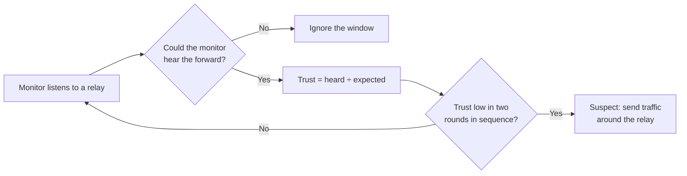
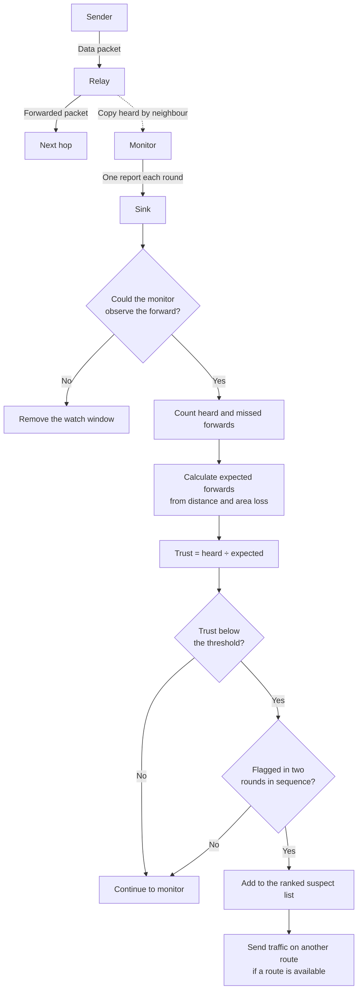
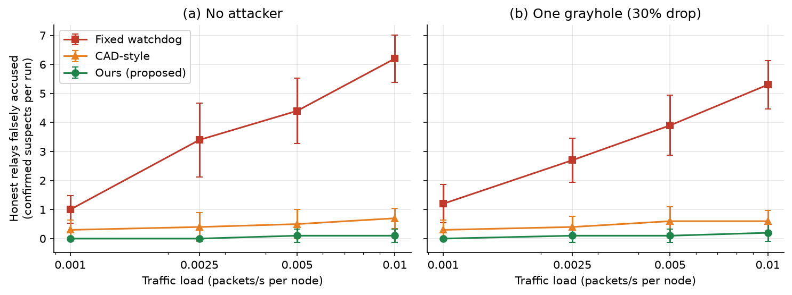
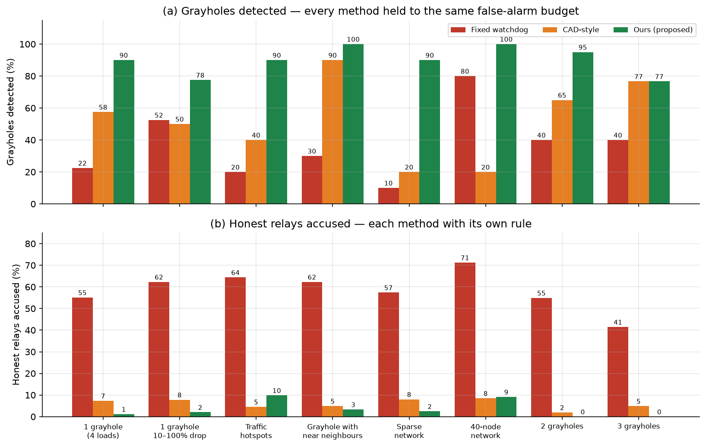
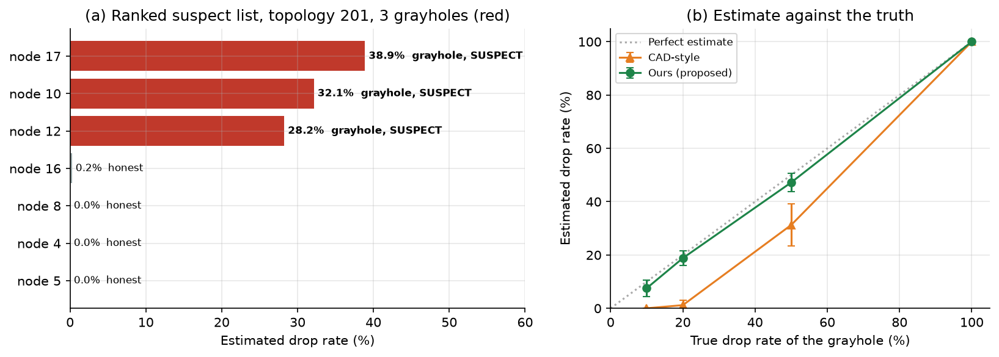
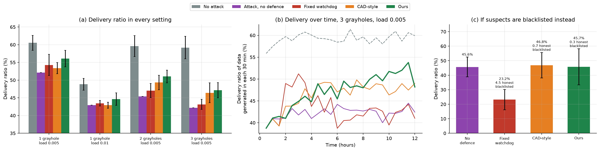

# **Observability-Aware Trust-Based Grayhole Detection for Underwater Acoustic Networks**

<p align="center">
  <a href="https://unetstack.net/"></a>
  
  
  
  <a href="LICENSE"></a>
  <a href="docs/abstract-proposal/Observability_Aware_Trust_Based_Grayhole_Detection_for_Underwater_Acoustic_Networks-2.pdf"></a>
  <a href="docs/research-paper/Observability_Aware_Trust_Based_Grayhole_Detection_for_Underwater_Acoustic_Networks-3.pdf"></a>
  <a href="docs/slides/Observability_Aware_Trust_Based_Grayhole_Detection_for_Underwater_Acoustic_Networks-4.pdf"></a>
</p>


## Summary

<details>
<summary>Details</summary>

| Category | Description |
| --- | --- |
| **Problem** | A grayhole relay drops some packets. The usual watchdog also accuses honest relays because underwater links naturally lose packets. |
| **Our solution** | The detector uses only the forwards that a monitor can hear. It compares them with the forwards that an honest relay sends on that link. |
| **Tool** | UnetStack 7.0.0 simulator, with agents written in Groovy. |
| **Result** | The detector finds 95% of grayholes. It accuses 0.3 honest relays per run, compared with 7.2 for the fixed watchdog. |

</details>


## Team Details

<details>
  <summary>Detail</summary>

> **Course:** CS301 Computer Networks Mini Project, 2026-27

> **Semester:** 5th Sem B. Tech. CSE, NITK Surathkal

> **Team ID:** T8

> **Member-1:** Appaji Nagaraja Dheeraj, 241CS110, [appajidheeraj.241cs110@nitk.edu.in](mailto:appajidheeraj.241cs110@nitk.edu.in), [@AppajiDheeraj](https://github.com/AppajiDheeraj)

> **Member-2:** Aryan Bokolia, 241CS111, [aryanbokolia.241cs111@nitk.edu.in](mailto:aryanbokolia.241cs111@nitk.edu.in), [@yoman12357](https://github.com/yoman12357)

> **Member-3:** Karthikeya Gupta, 241CS117, [karthikeyagupta.241cs117@nitk.edu.in](mailto:karthikeyagupta.241cs117@nitk.edu.in), [@karthikeyagupta108](https://github.com/karthikeyagupta108)

</details>


## Abstract

<details>
  <summary><b>Background</b></summary>

> Radio signals do not travel far in seawater. Thus, underwater sensor networks use acoustic modems.
> Sound travels at approximately 1500 m/s. Acoustic links send only a few kilobits per second.
> Noise, echoes and collisions damage many frames.
> A sensor on the seabed usually cannot send directly to the sink at the surface. Other sensors relay its packets.
> This routing occurs at the network layer. Each node must trust its neighbours to forward its packets.

</details>

<details>
  <summary><b>Challenges</b></summary>

> An attacker can capture a relay and make it a **grayhole**. A grayhole forwards some packets and drops the other packets.
> Encryption does not stop this attack, because the captured node has valid keys.
> Honest acoustic links also lose packets. Thus, a grayhole looks like a weak link.
> The usual defence is a **watchdog**. A node listens to make sure that its next hop forwards each packet.
> Under water, the watchdog often cannot hear the forward:
> - The modem cannot receive while it transmits.
> - Collisions and damaged frames hide forwards that occurred.

</details>

<details>
  <summary><b>Existing Methods</b></summary>

> - **Watchdog in UnetStack3:** It shows a selective forwarding attack and a method to find it. It uses a fixed threshold.
> - **Channel-aware detection (CAD):** It sets a threshold for each link from the expected loss. It was made for networks on land. It does not examine when the monitor cannot listen.
> - **Underwater trust models (for example, ARTMM):** They combine many trust values. They also do not examine when the monitor cannot listen.

</details>

<details>
  <summary><b>Problem Statement</b></summary>

> Watchdog detectors in underwater acoustic networks count each missed forward as a malicious drop.
> They do this also when the monitor was transmitting or could not receive.
> These false accusations increase with traffic. A grayhole can hide in the natural link loss.

</details>

<details>
  <summary><b>Objectives</b></summary>

> 1. Make a watchdog in UnetStack. It must count a missed forward only when the monitor could hear the forward.
> 2. Compare the missed forwards of each relay with the loss that is usual for its link. Give the administrator a ranked list of suspect relays.
> 3. Compare the detector with a fixed-threshold watchdog and a CAD-style detector. Measure the false accusations, the detection rate, the detection time and the packet delivery ratio.

</details>

<details>
  <summary><b>Key Terms</b></summary>

| Term | Meaning |
| --- | --- |
| Relay | A node that forwards packets from other nodes to the sink |
| Grayhole | A relay that drops a part of the packets that it must forward (30% in our tests) |
| Monitor | A neighbour node that listens to a relay |
| Sink | The node at the surface that collects all data and runs the detector |
| Watch window | One packet that the monitor expects the relay to forward |
| Trust | Forwards heard ÷ forwards that an honest relay sends on that link |
| Estimated drop | 1 − trust, shown as a percentage |
| Round | 30 minutes. The sink makes one decision in each round. |
| Suspect | A relay that the detector flags in two rounds in sequence |

</details>


## Proposed Method

<details>
  <summary>Overview</summary>

> The detector does three steps:
> 1. **Filter:** It removes each watch window that the monitor could not observe.
> 2. **Compare:** It compares the forwards heard with the forwards expected for that link distance.
> 3. **Decide:** It flags a relay that has low trust. The relay becomes a suspect after two rounds in sequence. The network then sends traffic around the suspect, if another route is available.



</details>

<details>
  <summary>Detailed Flowchart</summary>



> Each monitor sends one report to the sink in each round. The sink keeps the latest report from each monitor. Data packets and reports use the same acoustic channel.

</details>

<details>
  <summary>Improvement over the Baseline</summary>

| Part | Fixed watchdog (baseline) | Our detector |
| --- | --- | --- |
| Evidence | Counts each forward that it does not hear as a miss | Removes the windows that the monitor could not observe |
| Expected loss | Uses one fixed limit for all links | Uses the link distance and the usual loss in that area |
| Decision | Accuses when more than 30% of forwards are missed | Uses a threshold set from the network, and two-round confirmation |
| Many grayholes | Grayholes change the value of "usual loss" | Removes suspects from the "usual loss" value |
| Response | Removes the accused relay | Sends traffic on another route, if a route is available |

</details>

## Results

<details>
  <summary>Test Conditions</summary>

> - 20 nodes, 10 test topologies, 12 simulated hours.
> - Each grayhole drops 30% of its packets.
> - Six different topologies set the thresholds. The tests do not use these six topologies.

</details>

<details>
  <summary>Main Result</summary>


| Method | Grayholes found | Honest relays accused per run | Delivery ratio | Throughput |
| --- | ---: | ---: | ---: | ---: |
| No attack | – | – | 57.0% | 228.6 pkt/h |
| Attack, no defence | 0% | 0 | 45.6% | 186.8 pkt/h |
| Fixed watchdog | 100% | 7.2 | 47.0% | 190.6 pkt/h |
| CAD-style detector | 58% | 0.8 | 48.0% | 193.3 pkt/h |
| **Our detector** | **95%** | **0.3** | **49.7%** | **200.5 pkt/h** |

> - The fixed watchdog finds all grayholes. But it also accuses 7.2 honest relays per run.
> - Our detector accuses **96% fewer** honest relays than the fixed watchdog.
> - Our detector gives the highest delivery ratio and throughput.
> - The delivery gain over CAD-style is small. Most confidence intervals include zero.

</details>

<details>
  <summary>False Accusations When Traffic Increases</summary>


> More traffic causes more collisions. The fixed watchdog counts these collisions as drops.

</details>

<details>
  <summary>Detection on Each Scenario</summary>


> (a) All methods use the same false-alarm limit. (b) Each method uses its own threshold.

</details>

<details>
  <summary>Ranked Suspect List</summary>



> The sink gives this list to the administrator. Topology 201 has three grayholes: nodes 17, 10 and 12.

```text
rank  node  est. drop (%)   trust   decision   truth
1     17    38.9            0.61    SUSPECT    grayhole
2     10    32.1            0.68    SUSPECT    grayhole
3     12    28.2            0.72    SUSPECT    grayhole
4     16     0.2            1.00    -          honest
```

</details>

<details>
  <summary>Network Performance</summary>


> Delivery decreases when the attack starts. Delivery increases again when traffic goes around the grayholes. The report traffic is included.

</details>

<details>
  <summary>All Values</summary>

> All values and confidence intervals are in [`results/summary.md`](results/summary.md).

</details>

## How to Run

<details>
  <summary>Requirements</summary>

> - macOS on Apple Silicon
> - [UnetStack 7.0.0](https://unetstack.net/) community edition
> - Java 8 ([Azul Zulu 8](https://www.azul.com/downloads/?version=java-8-lts&os=macos&architecture=arm-64-bit&package=jdk), arm64). Do not use a newer Java.
> - Python 3 and [`uv`](https://docs.astral.sh/uv/) (only for the graphs)

</details>

<details>
  <summary>Setup</summary>

1. Clone the repository:
   ```bash
   git clone https://github.com/AppajiDheeraj/grayhole-sentinel.git
   cd grayhole-sentinel
   ```
2. Extract [UnetStack 7.0.0](https://unetstack.net/downloads/unet-community-7.0.0.tgz) into `tools/unet-7.0.0`.
3. Put the Java 8 JDK in `tools/jdk8`.
4. Link UnetStack to Java 8:
   ```bash
   mkdir -p tools/unet-7.0.0/runtimes
   ln -s ../../jdk8/Contents/Home tools/unet-7.0.0/runtimes/java
   ```

</details>

<details>
  <summary>Run the Demo</summary>

> The demo runs one network with three grayholes. It takes approximately 3 minutes.

```bash
./run.sh demo
```

<details>
  <summary>Expected Output</summary>

> The demo prints the delivery for each case and the ranked suspect list:

```text
topology 201, 3 grayhole(s) [10, 12, 17], load 0.005, nodefense: delivery 52.4%, suspects []
topology 201, 3 grayhole(s) [10, 12, 17], load 0.005, fixed: delivery 54.3%, suspects [2, 4, 6, 7, 8, 10, 11, 12, 14, 15, 17]
topology 201, 3 grayhole(s) [10, 12, 17], load 0.005, cad: delivery 58.4%, suspects [10, 12, 16, 17]
topology 201, 3 grayhole(s) [10, 12, 17], load 0.005, ours: delivery 59.4%, suspects [10, 12, 17]
   1. node 17  est. drop  41.8%  SUSPECT  (grayhole)
   2. node 10  est. drop  35.1%  SUSPECT  (grayhole)
   3. node 12  est. drop  32.6%  SUSPECT  (grayhole)
```

</details>

</details>

<details>
  <summary>All Commands</summary>

| Command | Function | Time |
| --- | --- | ---: |
| `./run.sh demo` | Runs one network and prints the ranked suspect list | Approximately 3 minutes |
| `./run.sh` | Tests the detector, compares all methods, runs the live networks and makes the graphs | Approximately 1 hour |
| `./run.sh record` | Records new evidence, then does the full run | Several hours |

> Run all commands from the repository root.

</details>

## Project Structure

<details>
  <summary>Detail</summary>

```text
grayhole-sentinel/
├── run.sh                       Runs the full pipeline or the demo
├── unet/
│   ├── MonitorNode.groovy       Each node: sends data, forwards, drops (if grayhole), monitors, reports
│   ├── Detectors.groovy         Fixed watchdog, CAD-style detector and our detector
│   ├── Topology.groovy          Node positions and routes to the sink
│   ├── DistanceLossChannel.groovy  Acoustic loss that increases with distance
│   ├── test_detectors.groovy    Self-test for the detectors
│   ├── record.groovy            Step 1: records the evidence of each monitor
│   ├── compare.groovy           Step 2: compares the detectors on the same evidence
│   └── network.groovy           Step 3: live network with reports and route changes
├── analysis/plots.py            Step 4: makes the five graphs and results/summary.md
├── results/                     Recorded evidence, result tables and graphs
└── docs/                        Abstract, research paper, slides and method notes
```

</details>


## Limitations

<details>
  <summary>Detail</summary>

> - The nodes do not move.
> - The simulation knows the position of each node and the channel loss curve.
> - All monitors send true reports.
> - Route changes do not cost time or packets.
> - The CAD-style detector is an adaptation. It is not a full copy of the published method.
> - In the hotspot and 40-node tests, our detector accuses approximately 10% of the honest relays.

</details>

## Next Phase

<details>
  <summary>Detail</summary>

> - **Administrator dashboard:** Show a map of the network, the trust of each node, the ranked suspect list and the new routes.
> - **3D deployment:** Put the nodes at different depths. Make sure that the detection rate stays the same.
> - **Final results:** Run the full pipeline again and complete the final report.

</details>

## References

<details>
  <summary>Detail</summary>

> 1. I. F. Akyildiz, D. Pompili and T. Melodia, "Underwater acoustic sensor networks: research challenges," *Ad Hoc Networks*, vol. 3, no. 3, pp. 257–279, 2005.
> 2. S. Marti, T. J. Giuli, K. Lai and M. Baker, "Mitigating routing misbehavior in mobile ad hoc networks," in *Proc. ACM MobiCom*, 2000, pp. 255–265.
> 3. B. R. Chandavarkar and N. Suresh, "Demonstration of selective forwarding attack and detection mechanism in UnetStack3," in *Proc. ICCCNT*, 2021, pp. 1–6.
> 4. D. M. Shila, Y. Cheng and T. Anjali, "Channel-aware detection of gray hole attacks in wireless mesh networks," in *Proc. IEEE GLOBECOM*, 2009.
> 5. G. Han, J. Jiang, L. Shu and M. Guizani, "An attack-resistant trust model based on multidimensional trust metrics in underwater acoustic sensor network," *IEEE Trans. Mobile Computing*, vol. 14, no. 12, pp. 2447–2459, 2015.
> 6. C. Liu, J. Ye, F. An and W. Jiang, "An adaptive trust evaluation model for detecting abnormal nodes in underwater acoustic sensor networks," *Sensors*, vol. 24, no. 9, art. 2880, 2024.
> 7. M. Chitre, R. Bhatnagar and W.-S. Soh, "UnetStack: an agent-based software stack and simulator for underwater networks," in *Proc. IEEE OCEANS*, 2014.

</details>

## License

<details>
  <summary>Detail</summary>

> This project uses the [MIT License](LICENSE).

</details>
