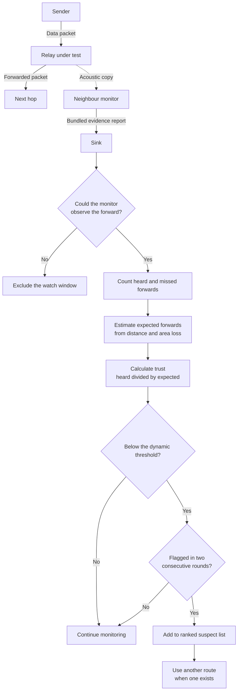
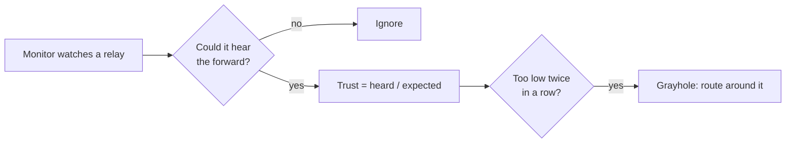

# Observability-Aware Trust-Based Grayhole Detection for Underwater Acoustic Networks

<p align="center">
  <a href="https://unetstack.net/"></a>
  <a href="LICENSE"></a>
  
  
  <a href="https://github.com/AppajiDheeraj/uwan-grayhole-detection/graphs/contributors"></a>
</p>

## The Idea

A **grayhole** is a relay that secretly drops some of the packets it should forward.
The usual watchdog blames a relay whenever it doesn't hear the forward. But under water, forwards also get lost to collisions and long links, so **honest relays get blamed too**.
We only judge forwards the monitor **could actually hear**, and compare them with how many an **honest relay should** deliver on that link.





Each node can monitor its neighbour relays. Each monitor sends one evidence report per round. The sink keeps the latest report. It combines the reports and runs the detector. Data packets and report packets use the same acoustic channel.

## What changed

| Part | Fixed watchdog | This project |
| --- | --- | --- |
| Evidence | Counts each unheard forward as a miss | Excludes a window when the monitor could not observe the forward |
| Expected loss | Uses one fixed miss limit | Uses distance and the median loss for the link area |
| Decision | Accuses after the miss rate exceeds 30% | Uses a network-based threshold and two-round confirmation |
| Several attackers | Lets grayholes affect the normal-loss estimate | Removes confirmed suspects and relays with at least 10% estimated drop from that estimate |
| Response | Can remove an accused relay | Uses another route only when one exists |

The specific improvement is the combination of the observability filter, the per-link loss estimate, and baseline cleaning. The comparison includes a fixed watchdog and a channel-aware CAD-style detector.

## Results

The live test uses 20 nodes, 10 test topologies, 12 simulated hours, and grayholes that drop 30% of their packets. Six separate topologies set the detector thresholds.


| Method | Grayholes caught | Honest relays accused per run | Delivery ratio | Throughput |
| --- | ---: | ---: | ---: | ---: |
| No attack | Not applicable | Not applicable | 57.0% | 228.6 packets per hour |
| Attack with no defence | 0% | 0 | 45.6% | 186.8 packets per hour |
| Fixed watchdog | 100% | 7.2 | 47.0% | 190.6 packets per hour |
| CAD-style detector | 58% | 0.8 | 48.0% | 193.3 packets per hour |
| **Proposed detector** | **95%** | **0.3** | **49.7%** | **200.5 packets per hour** |

The fixed watchdog catches all grayholes, but it also accuses many honest relays. The proposed detector makes 96% fewer false accusations than that watchdog. It gives the highest mean delivery ratio and throughput in this test. Most confidence intervals for its delivery gain over CAD-style include zero. The data does not prove that this gain will occur in every network.

See [the full results](results/summary.md) for confidence intervals, detection by scenario, the ablation test, and all five graphs.

## Quick start

Use macOS on Apple Silicon. Put UnetStack 7.0.0 in `tools/unet-7.0.0`. Its `runtimes/java` path must point to Java 8. Install Python 3 and [`uv`](https://docs.astral.sh/uv/) for the graphs.

```bash
./run.sh demo
./run.sh
./run.sh record
```

| Command | Purpose | Typical time |
| --- | --- | ---: |
| `./run.sh demo` | Run one network with three grayholes and print the ranked suspect list | About 3 minutes |
| `./run.sh` | Test the detector, replay recorded evidence, run live networks, and make all graphs | About 1 hour |
| `./run.sh record` | Record new evidence before the full run | Several hours |

Do not use the system Java 25. UnetStack 7.0.0 needs Java 8. Run the scripts from the repository root.

## Pipeline and core files

| Step | File | Output |
| --- | --- | --- |
| Record evidence | [`unet/record.groovy`](unet/record.groovy) | `results/evidence.csv` and `results/evidence_cal.csv` |
| Compare detectors | [`unet/compare.groovy`](unet/compare.groovy) | Thresholds, run data, ablation data, and the suspect list |
| Run the live network | [`unet/network.groovy`](unet/network.groovy) | Delivery, throughput, delay, route response, and report overhead |
| Make graphs | [`analysis/plots.py`](analysis/plots.py) | Five figures and `results/summary.md` |

The main agents are in [`unet/MonitorNode.groovy`](unet/MonitorNode.groovy) and [`unet/Detectors.groovy`](unet/Detectors.groovy). [`unet/Topology.groovy`](unet/Topology.groovy) defines the nodes and routes. [`unet/DistanceLossChannel.groovy`](unet/DistanceLossChannel.groovy) defines distance-based acoustic loss. [`unet/test_detectors.groovy`](unet/test_detectors.groovy) is the detector self-check.

## Detection output

The sink ranks every judged relay by its estimated drop rate.

```text
rank  node  est. drop (%)   trust   decision   truth
1     17    38.9            0.61    SUSPECT    grayhole
2     10    32.1            0.68    SUSPECT    grayhole
3     12    28.2            0.72    SUSPECT    grayhole
4     16     0.2            1.00    -          honest
```

## Limits

- The nodes do not move.
- The simulation knows each node position and the channel loss curve.
- Monitor reports are truthful.
- Route updates have no time or packet cost.
- CAD-style is an adaptation, not a full reproduction of a published system.
- The proposed detector accuses about 10% of honest relays in the hotspot and 40-node tests.

## Contributors

| Name | Roll number | GitHub |
| --- | --- | --- |
| Appaji Nagaraja Dheeraj | 241CS110 | [@AppajiDheeraj](https://github.com/AppajiDheeraj) |
| Aryan Bokolia | 241CS111 | [@yoman12357](https://github.com/yoman12357) |
| Karthikeya Gupta | 241CS117 | [@karthikeyagupta108](https://github.com/karthikeyagupta108) |

## License

This project uses the [MIT License](LICENSE).